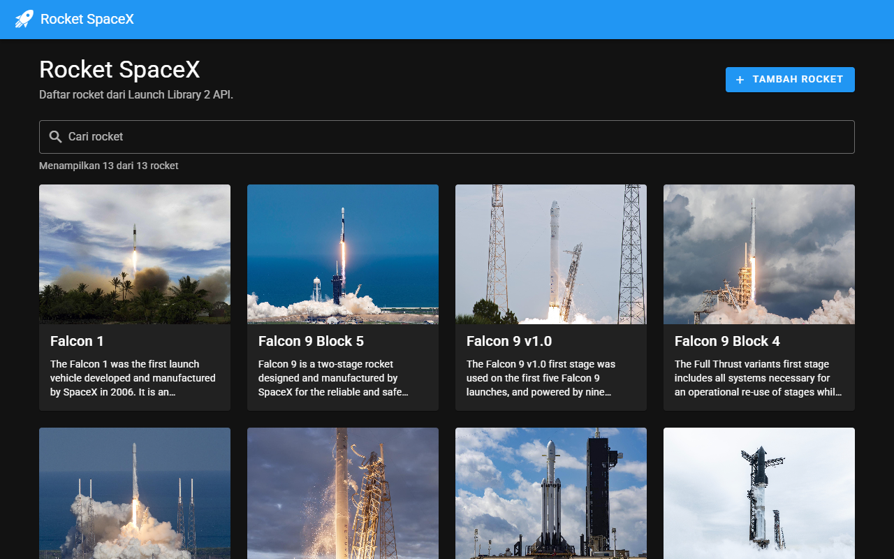
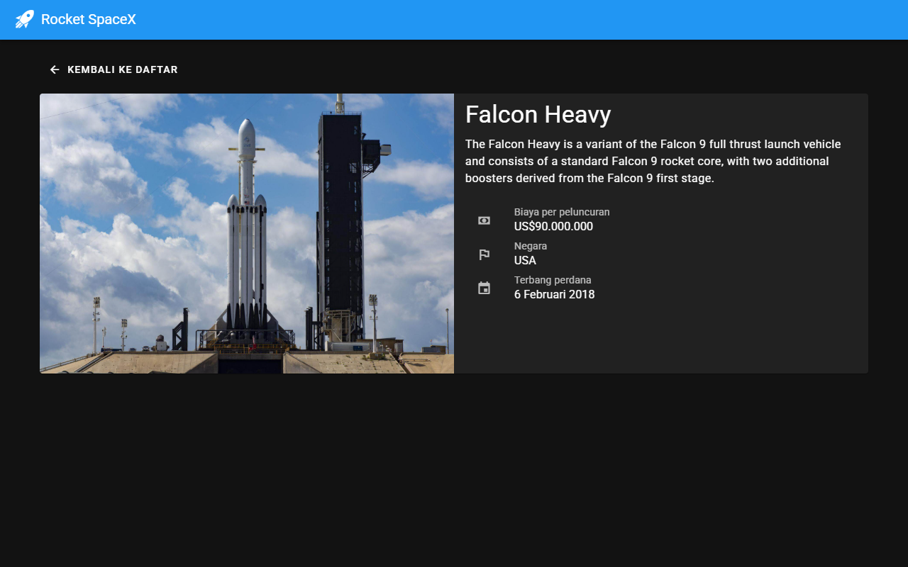
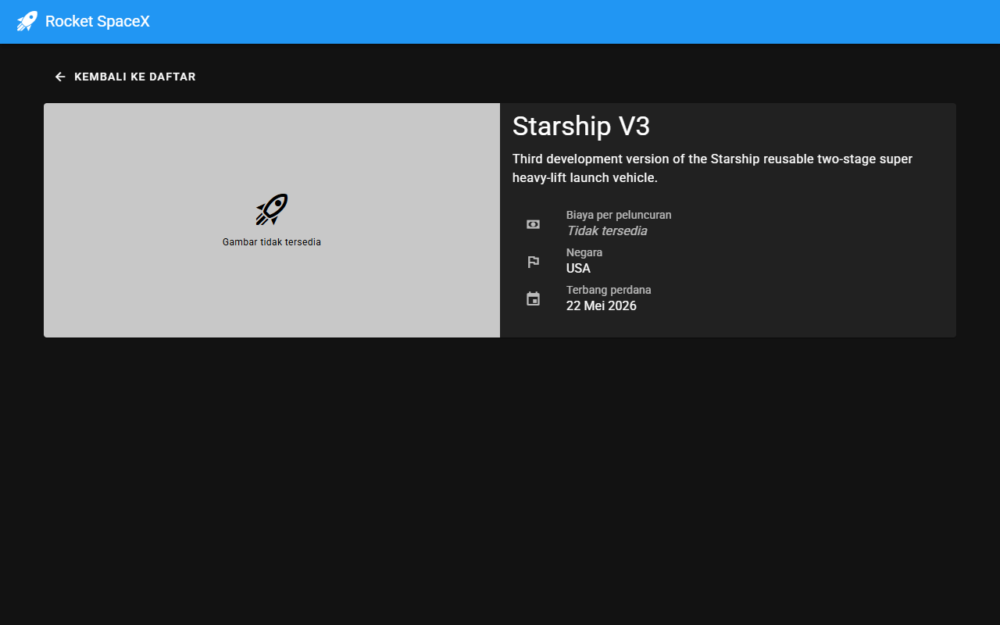
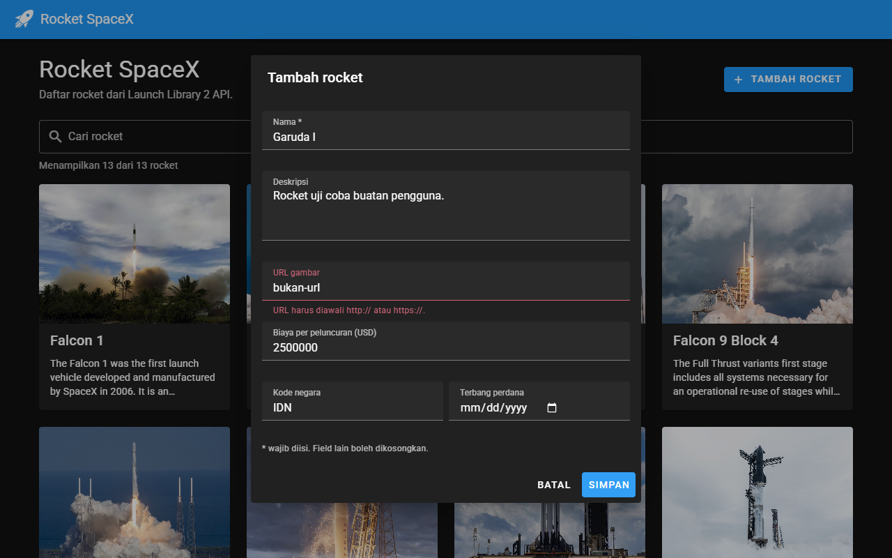
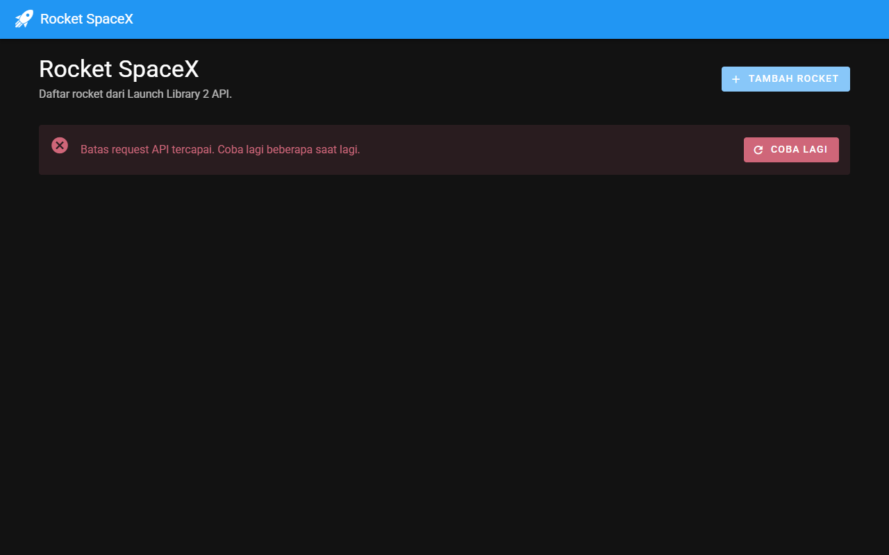
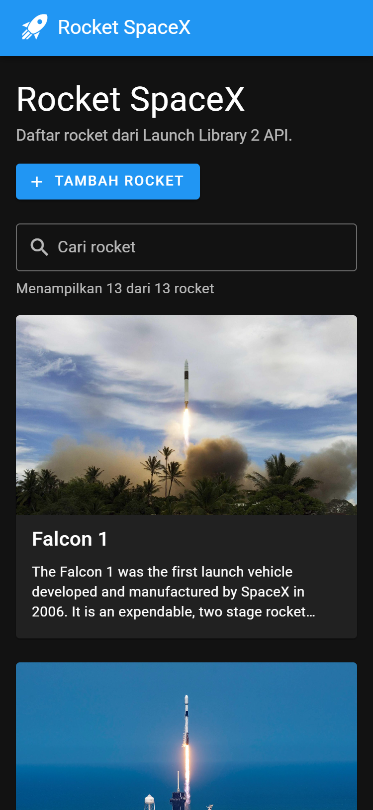
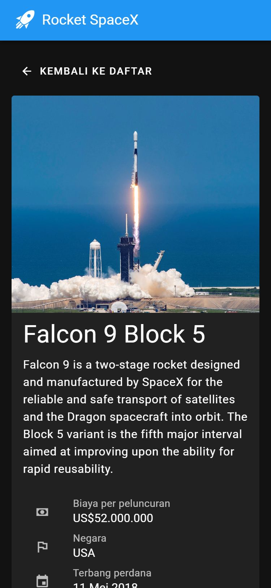

# Rocket SpaceX

Website dua layar (list dan detail) yang menampilkan rocket SpaceX dari
[Launch Library 2 API](https://thespacedevs.com/llapi) **v2.2.0**. Dibuat untuk
[Allo Bank Frontend Technical Assignment](https://github.com/allobankdev/allo-frontend-test).



## Daftar isi

- [Tech stack](#tech-stack)
- [Menjalankan proyek](#menjalankan-proyek)
- [Pemetaan fitur ke requirement](#pemetaan-fitur-ke-requirement)
- [Struktur folder](#struktur-folder)
- [Keputusan arsitektur](#keputusan-arsitektur)
- [Testing](#testing)
- [Screenshot](#screenshot)
- [Catatan dan batasan](#catatan-dan-batasan)

## Tech stack

Mengikuti scaffold dari repo upstream, ditambah tiga dependency:

| Kebutuhan | Pustaka |
| --- | --- |
| Framework | Vue 3 (`<script setup>` + TypeScript) |
| UI | Vuetify 3 |
| Router | `vue-router` + `unplugin-vue-router` (routing berbasis file) |
| Build | Vite 5 |
| State management | **Pinia** (tambahan) |
| Test | **Vitest** + `@vue/test-utils` + `jsdom` (tambahan) |
| Lint dan tipe | ESLint 9, `vue-tsc` |
| Pesan commit | **commitlint** + **husky** (tambahan) |

## Menjalankan proyek

Prasyarat: Node.js 22 atau lebih baru dan npm. Proyek ini diuji dengan Node.js 24.18 dan npm 11.16.

```bash
npm install
```

| Perintah | Fungsi |
| --- | --- |
| `npm run dev` | Server development di http://localhost:3000 |
| `npm run build` | Type-check (`vue-tsc`) lalu build produksi ke `dist/` |
| `npm run preview` | Menyajikan hasil build secara lokal |
| `npm test` | Menjalankan semua unit test satu kali |
| `npm run test:watch` | Menjalankan test dalam mode watch |
| `npm run type-check` | Hanya pengecekan tipe |
| `npm run lint` | ESLint dengan `--fix` (bawaan scaffold, langsung mengubah file) |

`npm install` juga memasang hook `commit-msg` lewat script `prepare`, sehingga
setiap pesan commit divalidasi commitlint.

## Pemetaan fitur ke requirement

### Fungsional

| Requirement | Implementasi |
| --- | --- |
| List rocket: gambar, nama, deskripsi | [`pages/index.vue`](src/pages/index.vue) merender [`RocketCard`](src/components/RocketCard.vue) dalam grid responsif |
| Filter rocket | Input "Cari rocket" mencocokkan nama dan deskripsi tanpa peka huruf besar/kecil ([`filterRockets`](src/utils/filterRockets.ts)). Ada empty state jika tidak ada hasil |
| Tambah rocket (hanya di state aplikasi) | [`AddRocketDialog`](src/components/AddRocketDialog.vue) dengan validasi, lalu `addRocket` di store. Rocket baru tampil paling atas dan bisa dibuka detailnya |
| Detail rocket: gambar, nama, deskripsi, biaya per peluncuran, negara, terbang perdana | [`pages/rockets/[id].vue`](src/pages/rockets/[id].vue) |
| Tetap tampil benar saat data tidak lengkap | Lihat [Penanganan data yang hilang](#penanganan-data-yang-hilang) |

### Non-fungsional

| Requirement | Implementasi |
| --- | --- |
| Memakai Launch Library 2 API | [`services/rocketApi.ts`](src/services/rocketApi.ts), versi 2.2.0, host `lldev` |
| Router | Routing berbasis file: `/` dan `/rockets/:id` |
| State management | Pinia setup store [`stores/rocket.ts`](src/stores/rocket.ts) |
| Lifecycle | `onMounted` memuat list; `watch` pada id route memuat ulang detail |
| Komponen reusable | `AsyncState`, `RocketImage`, `RocketCard`, `AddRocketDialog` |
| UI state Loading, Fail/Retry, Success | [`AsyncState`](src/components/AsyncState.vue) dipakai di kedua layar. Tombol "Coba lagi" memicu request ulang |
| Responsive (nice to have) | Grid 1/2/3/4 kolom, dan layout detail bertumpuk di layar kecil |

### Mapping field API

| Requirement | Field API v2.2.0 | Field model `Rocket` |
| --- | --- | --- |
| Gambar | `image_url` | `imageUrl` |
| Nama | `full_name` | `name` |
| Deskripsi | `description` | `description` |
| Biaya per peluncuran | `launch_cost` (string angka) | `launchCost` (number) |
| Negara | `manufacturer.country_code` | `countryCode` |
| Terbang perdana | `maiden_flight` | `maidenFlight` |

## Struktur folder

```text
src/
├── components/          # Komponen UI reusable (otomatis di-import oleh unplugin-vue-components)
│   ├── AddRocketDialog.vue
│   ├── AsyncState.vue
│   ├── RocketCard.vue
│   └── RocketImage.vue
├── composables/
│   └── useRocketDetail.ts   # Pengambilan data detail + state UI
├── pages/               # Setiap file menjadi rute (unplugin-vue-router)
│   ├── index.vue            # /
│   └── rockets/[id].vue     # /rockets/:id
├── plugins/             # Registrasi Vuetify, router, Pinia
├── router/              # Instance router
├── services/
│   ├── rocketApi.ts         # Request ke Launch Library 2
│   └── rocketMapper.ts      # DTO API -> model Rocket
├── stores/
│   └── rocket.ts            # Store Pinia: list, cache, filter, tambah rocket
├── test/setup.ts        # Setup global Vitest
├── types/
│   ├── launchLibrary.ts     # Tipe respons API
│   └── rocket.ts            # Model domain Rocket
└── utils/               # Fungsi murni: filter, format, pesan error, form
```

Test berada di folder `__tests__` di samping kode yang diuji.

## Keputusan arsitektur

### Alur data

```text
Halaman (pages/*)  ──>  Store Pinia (stores/rocket.ts)  ──>  Service (services/rocketApi.ts)  ──>  Launch Library 2
       ^                         │                                   │
       └──── komponen UI ◄───────┘ model Rocket ◄── rocketMapper ◄───┘ DTO
```

- **Service** hanya tahu HTTP dan bentuk respons API. Status non-2xx dilempar
  sebagai `ApiError` yang membawa kode status.
- **Mapper** adalah satu-satunya tempat yang mengenal nama field API. Komponen
  hanya memakai model `Rocket`, jadi perubahan API cukup ditangani di satu file.
- **Store** menyimpan data dan memutuskan kapan perlu request.
- **Komponen** hanya menerima data lewat props dan memancarkan event.
  `AddRocketDialog`, misalnya, tidak menyimpan ke store sendiri; halaman yang
  menyimpannya.

### Router

`unplugin-vue-router` dari scaffold membuat rute dari isi folder `src/pages`.
Rute-rutenya bertipe (`typed-router.d.ts`), sehingga
`useRoute('/rockets/[id]')` mengembalikan `params.id` bertipe `string`. Kartu
rocket memakai link biasa (`:to`), jadi detail bisa dibuka di tab baru dan URL
detail bisa dibagikan.

### State management

Satu setup store Pinia, [`useRocketStore`](src/stores/rocket.ts):

- `apiRockets` dan `customRockets` disimpan terpisah. Getter `rockets` menggabungkan
  keduanya dengan rocket buatan pengguna di urutan teratas.
- `searchQuery` berada di store, bukan di halaman, supaya kata kunci filter tetap ada
  saat pengguna kembali dari halaman detail.
- `listStatus` (`idle | loading | error | success`) dan `listError` menjadi
  sumber state UI.
- State loading/error halaman detail dipegang composable
  [`useRocketDetail`](src/composables/useRocketDetail.ts), karena state itu milik
  satu halaman, bukan data global.

### Penanganan data yang hilang

Dari respons asli, 6 dari 13 rocket tidak punya `launch_cost`, satu tidak punya
`image_url`, dan dua tidak punya `maiden_flight`. Penanganannya berlapis:

1. **Normalisasi di mapper**: string kosong dan nilai tidak valid (misalnya biaya
   bukan angka atau negatif) diubah menjadi `null`. Komponen cukup mengecek `null`.
2. **Format dengan fallback** ([`utils/format.ts`](src/utils/format.ts)): biaya,
   tanggal, dan negara yang `null` ditampilkan sebagai "Tidak tersedia", dicetak
   miring.
3. **Gambar** ([`RocketImage`](src/components/RocketImage.vue)): URL `null`
   *atau* gambar yang gagal dimuat diganti placeholder "Gambar tidak tersedia".
4. **Deskripsi** kosong ditampilkan sebagai "Deskripsi belum tersedia."

Rocket buatan pengguna melewati jalur yang sama, karena field opsional yang
dikosongkan di form juga disimpan sebagai `null`.

### Strategi hemat rate limit

API anonim dibatasi 15 request/jam (host produksi `ll`). Selama development
dipakai host `lldev`, dan aplikasi hanya melakukan request yang benar-benar perlu:

| Teknik | Lokasi |
| --- | --- |
| Base URL dikunci ke `lldev.thespacedevs.com/2.2.0` dalam satu konstanta | `LL2_BASE_URL` di `rocketApi.ts` |
| Semua 13 rocket diambil dalam **satu** request (`mode=detailed&limit=20`) | `fetchRockets` |
| List di-cache di store; kembali dari detail tidak memicu request | `loadRockets` (lewati jika status `success`) |
| Pemanggilan `loadRockets` bersamaan berbagi satu promise | `pendingList` di store |
| Detail diambil dari cache list, tanpa request | `loadRocketById` → `findRocket` |
| Detail yang dibuka langsung lewat URL di-cache setelah fetch pertama | `detailCache` |
| Id rocket buatan pengguna (`custom-…`) tidak pernah dikirim ke API | `loadRocketById` |
| Request ulang hanya saat pengguna menekan "Coba lagi" | `loadRockets({ force: true })` |
| Unit test memakai `fetch` tiruan, sehingga tidak memakai jatah API | `vi.stubGlobal` / `vi.mock` |

Hasilnya: membuka aplikasi, berpindah ke beberapa detail, lalu kembali ke list
hanya memakai **1 request**.

### Penanganan error

[`getErrorMessage`](src/utils/errorMessage.ts) menerjemahkan error menjadi pesan untuk pengguna:

- 404: "Rocket tidak ditemukan."
- 429: batas request tercapai.
- Status lain: error server, disertai kode HTTP.
- Error jaringan: masalah koneksi.

Pada halaman detail, respons yang datang terlambat untuk id lama diabaikan, supaya
tidak menimpa rocket yang sedang tampil.

## Testing

```bash
npm test
```

Ada 51 test di 10 file:

| Area | Yang diuji |
| --- | --- |
| `rocketMapper` | Mapping semua field, null tetap null, string kosong menjadi null, biaya tidak valid, manufacturer kosong |
| `rocketApi` | URL memuat `mode=detailed` dan `limit=20`, hasil sudah dipetakan, status 404/429 melempar `ApiError` |
| Store `rocket` | Cache list, penggabungan request bersamaan, error lalu retry, tambah rocket, filter, detail dari cache/API/id custom |
| `useRocketDetail` | Cache, loading lalu success, error lalu retry, respons lama diabaikan saat id berganti |
| `filterRockets`, `format`, `errorMessage`, `rocketForm` | Fungsi murni: filter, format dan fallback, pesan error, validasi dan konversi form |
| `AsyncState`, `RocketImage` | Tiga state UI dan event retry; placeholder saat URL null atau gambar gagal |

## Screenshot

| Detail rocket | Detail dengan data kosong |
| --- | --- |
|  |  |

| Tambah rocket dengan validasi | State Fail + Retry |
| --- | --- |
|  |  |

| Mobile: list | Mobile: detail |
| --- | --- |
|  |  |

## Catatan dan batasan

- **Rocket tambahan hanya ada di memori.** Sesuai requirement, rocket yang ditambahkan
  hilang saat halaman di-reload. Membuka URL detail rocket seperti itu setelah reload
  menampilkan "Rocket tidak ditemukan." tanpa request ke API.
- **Negara ditampilkan sebagai kode tiga huruf** (`USA`) sesuai data API, tanpa
  konversi ke nama negara.
- **Dua dependency scaffold dikunci versinya.** Upstream tidak menyertakan lockfile,
  jadi `npm install` baru mengambil versi terbaru yang membuat type-check gagal:
  - `@tsconfig/node22` 22.0.7 memakai `lib: es2024` yang belum dikenal TypeScript
    5.6, jadi dikunci ke `22.0.0`.
  - `vue-router` 4.6 mengubah `vue-router-auto.d.ts`, sehingga import
    `vue-router/auto` gagal. Versinya dikunci ke `~4.5.1`.

  `package-lock.json` kini ikut di-commit.
- **Pesan commit** mengikuti Conventional Commits (`feat`, `fix`, `refactor`, `test`, `docs`,
  `build`, `ci`, `chore`; header maksimal 100 karakter) dan divalidasi commitlint.
