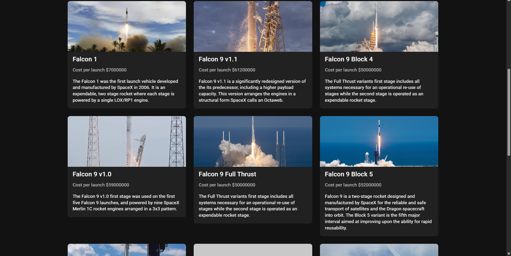
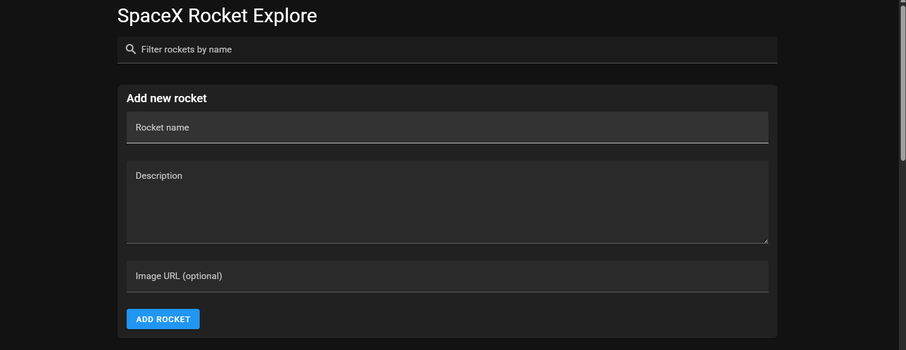
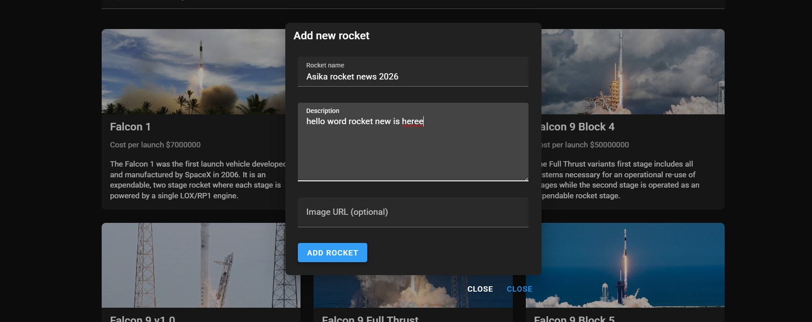
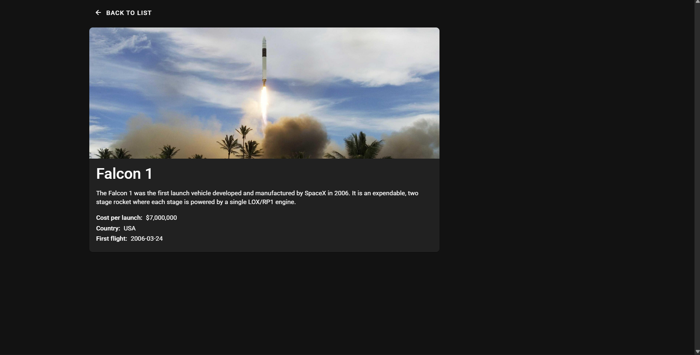

# SpaceX Rocket Explorer — Allo Bank Frontend Challenge

A web app for browsing, filtering, and locally adding SpaceX rocket data, built as a submission for the Allo Bank frontend technical assignment. Data comes from the Launch Library 2 API.

**Stack:** Vue 3 + TypeScript + Vite + Vuetify. State management uses a lightweight composable store (no Pinia), and navigation uses file-based routing (`unplugin-vue-router`).

## Features

- **Rocket list** — responsive card grid showing each rocket's image, name, and description. Missing images fall back to a placeholder icon, missing text falls back to a default message.
- **Filter** — client-side filtering by rocket name, with an empty state when nothing matches.
- **Add rocket (local)** — a validated form (name and description required, image URL optional) that adds a rocket to app state only, since the API is read-only. New rockets appear at the top of the list.
- **UI states** — loading indicator, error message with a Retry button, success, and empty states.

## Screenshots

Current state of the app, captured before further improvements (source files in [`dokumentasi_projek/`](./dokumentasi_projek)):


*Rocket list — all 13 SpaceX rockets from the API*


*Client-side filtering — searching "falcon"*


*Empty state — no rocket matches the keyword*


*Add rocket form — validated, new rocket appears at the top of the list*


*Rocket detail — full fields with fallbacks (Starship V3: placeholder image, no cost)*

## Learnings

### Requirement data

Reading the API documentation before writing code mattered: the LL2 `2.2.0` list endpoint requires `mode=detailed&limit=20` to return descriptions and all 13 SpaceX rockets in one request. Several fields (`launch_cost`, `image_url`, `maiden_flight`) can be `null`, so every UI field needs a fallback path.

### Data fetching

A small typed `getJson<T>` wrapper checks `response.ok` before parsing JSON, keeping HTTP error handling in one place. The API base URL is read from the `VITE_API_BASE` environment variable with a hardcoded fallback, so the app runs with zero configuration while still being configurable per environment.

### Rocket list

API types (`LauncherConfigApi`) are kept separate from UI types (`Rocket`) through a mapper in the service layer, so components never depend on the API's raw shape. `RocketCard` is a reusable component; the list page only composes store state and handles layout.

### Rocket detail

The detail page reuses data instead of re-fetching blindly. On load it first
checks the rocket list already held in the store — so clicking a card (including
locally added rockets) opens instantly with zero API calls. Only when the id is
not in the list (for example on a hard page refresh of a detail URL) does it
fall back to a single request to `/config/launcher/:id/`. Costs are formatted
with `toLocaleString` (`"7000000"` → `$7,000,000`), and missing fields render
as a placeholder image or `—` instead of crashing the view.

### Integration

Clear layering: `services/` (fetching + mapping) → `stores/` (state, actions) → `components/` and `pages/` (UI only). `import type` is used everywhere because of `verbatimModuleSyntax`, keeping type imports erased at compile time.

## Usage

## Usage

```bash
npm install
npm run dev
npm run type-check
npm run build
Required configuration via .env:

VITE_API_BASE=https://lldev.thespacedevs.com/2.2.0
The app fails fast if this variable is missing. Note: VITE_API_BASE is not
a secret mechanism — everything shipped to the browser is public. It exists
purely for per-environment configuration.

Optional configuration via `.env`:

```
VITE_API_BASE=https://lldev.thespacedevs.com/2.2.0
```

If unset, the app falls back to the LL2 dev host above. The dev host serves the same data as production (`ll.thespacedevs.com`) with a much more generous rate limit for development.

## Next improvements

- Rocket detail page (`/rockets/:id`) — in progress
- Image URL validation on the add form
- Unit tests for the service and store layers
